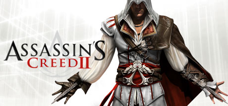

**The original Assassin's Creed established the open-world stealth formula following Altaïr Ibn-La'Ahad across the Third Crusade in 1191 AD Jerusalem, Damascus, and Acre. A historically revolutionary game despite repetitive mission design.**

---

## 📖 About

The original Assassin's Creed established the open-world stealth formula following Altaïr Ibn-La'Ahad across the Third Crusade in 1191 AD Jerusalem, Damascus, and Acre. A historically revolutionary game despite repetitive mission design.

## ⚠️ Problems Without Trainer

| Problem | Status |
|---------|--------|
| **Mission Repetition** — Each assassination preceded by identical investigation mission types | ✅ Solved |
| **Investigation Grind** — Must complete 3-4 investigations before each assassination | ✅ Solved |
| **Limited Abilities** — Altaïr starts with restricted move set requiring flag collection to unlock | ✅ Solved |
| **Flag Collectibles** — 420+ Templar and Crusader flags to collect for completion | ✅ Solved |

## ✅ Solution

The **Assassin's Creed Trainer** solves all these issues by giving you complete control over the game.

## 🎯 Full Feature List

- Unlimited Resources
- God Mode / Invincibility
- Instant Skill Cooldown
- One-Hit Kill
- Freeze Game Timer
- Unlock All Items & Achievements
- Custom Speed Multiplier
- Save State Anywhere

## 🚀 Quick Start

1. **Disable Windows Defender** temporarily (trainer may trigger false positive)
2. Download the trainer from the button above
3. Launch Assassin's Creed
4. Run the trainer as Administrator
5. Activate desired cheats with hotkeys

## 💎 Free vs Paid

| Feature | Free | Pro |
|---------|------|-----|
| Basic God Mode | ✅ | ✅ |
| Unlimited Resources | ✅ | ✅ |
| All Advanced Cheats | ❌ | ✅ |
| Auto-Updates | ❌ | ✅ |
| Priority Support | ❌ | ✅ |

## 💻 Requirements

- Windows 10/11 (64-bit)
- Assassin's Creed (any version)
- .NET Framework 4.8+
- DirectX 11+

## 🍎 macOS

macOS users can use our alternative tool:

## ⚖️ Legal

This trainer is for educational and single-player use only. Use responsibly.

---

